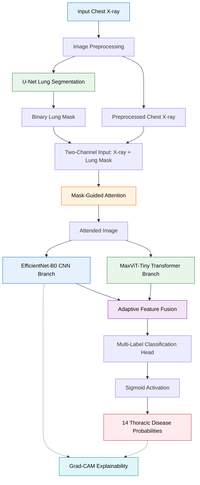

# SegFusionFormer — System Architecture

## Proposed Architecture

SegFusionFormer is a segmentation-guided, explainable
hybrid CNN–Transformer framework for multi-label
thoracic disease classification.

## Architecture Components

### 1. Input and Preprocessing

Chest radiographs are loaded and preprocessed
before segmentation and classification.

### 2. Lung Segmentation

A U-Net architecture generates lung-field
segmentation masks.

### 3. Segmentation-Guided Attention

The chest X-ray and its corresponding lung mask
are combined to guide feature learning toward
anatomically relevant regions.

### 4. Hybrid Feature Extraction

EfficientNet-B0 extracts convolutional features,
while MaxViT-Tiny extracts complementary
transformer-based representations.

### 5. Adaptive Feature Fusion

The framework combines the extracted features
using a learnable adaptive fusion mechanism.

### 6. Multi-Label Classification

The classification head produces probabilities
for 14 thoracic disease categories.

### 7. Explainable AI

Grad-CAM provides visual explanations of
model predictions.

## Implementation

The corresponding implementations are available in:

- `notebooks/03_Lung_Segmentation.ipynb`
- `notebooks/04_Disease_Classification.ipynb`
- `notebooks/05_Explainable_AI_Analysis.ipynb`

This diagram is a conceptual representation of
the implemented research architecture.
