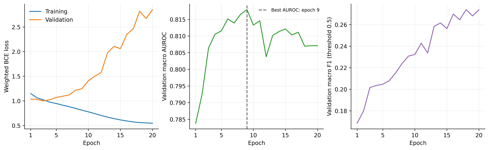
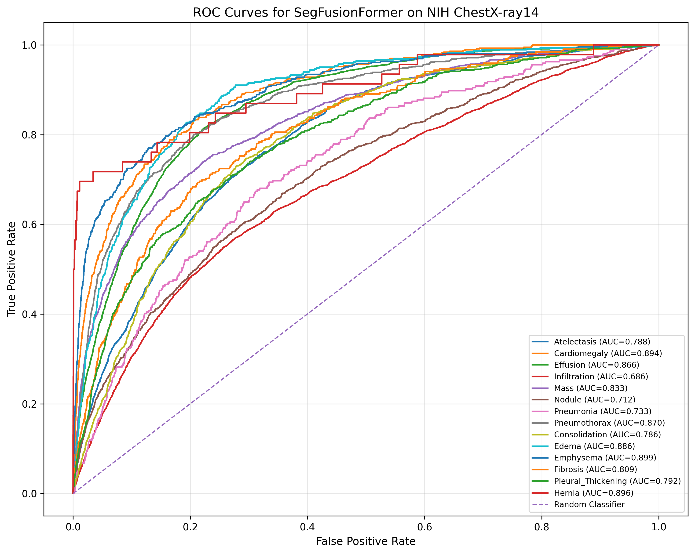
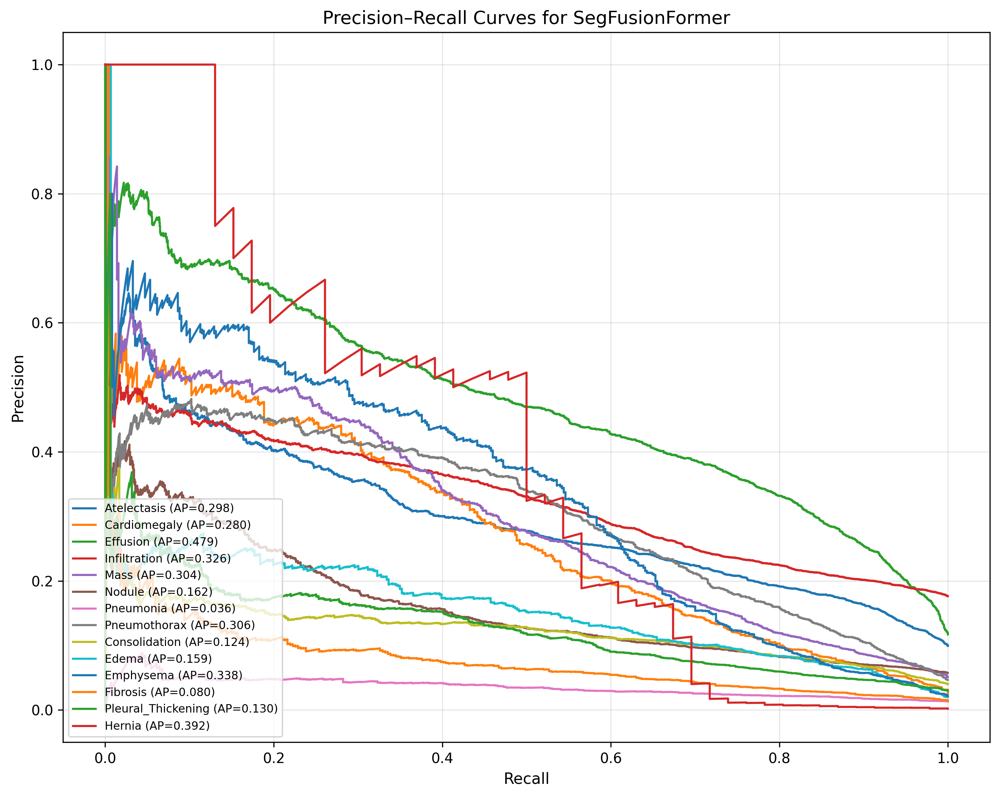
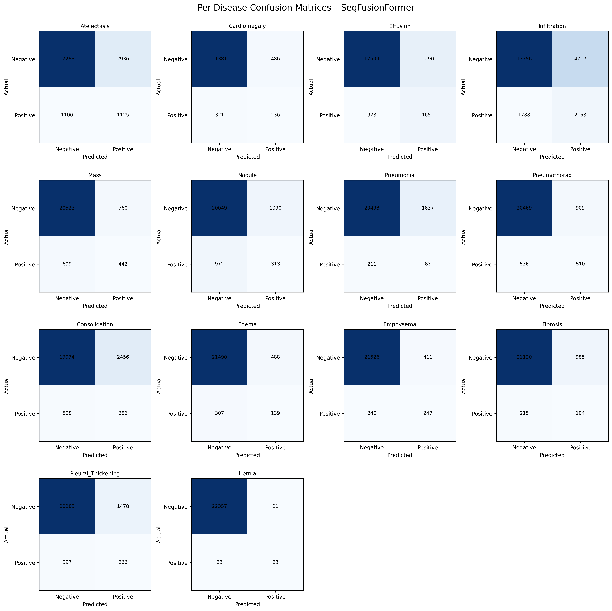
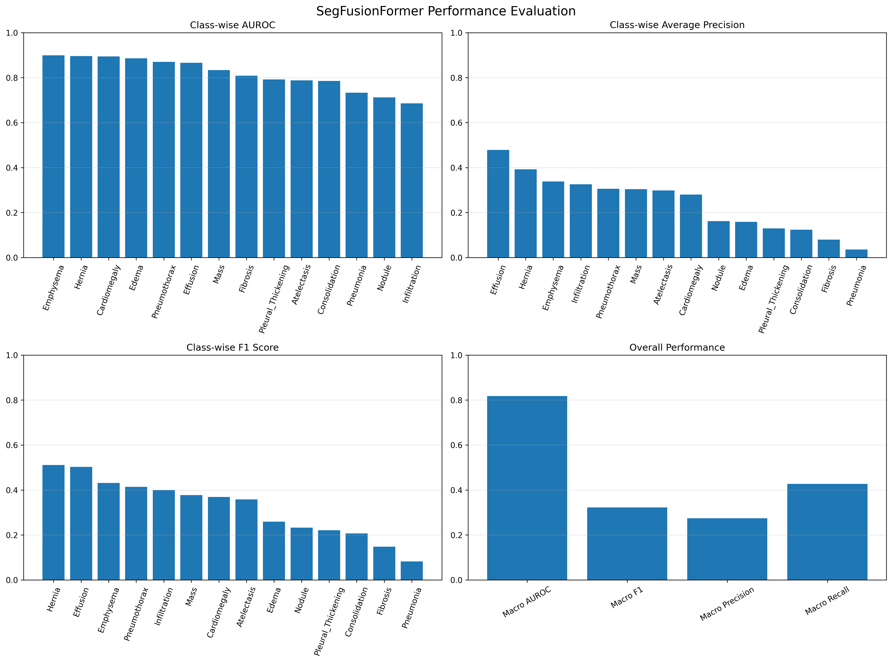
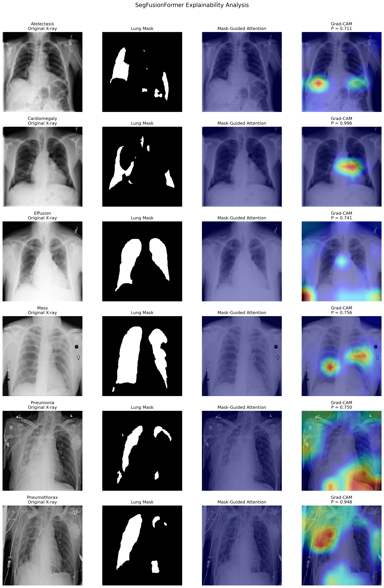
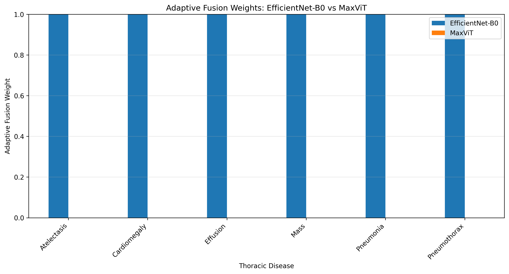

# SegFusionFormer — Experimental Results

## Overview

This directory contains experimental results generated
during the development and evaluation of SegFusionFormer.

The results include training convergence, classification
evaluation, explainable AI visualizations, and numerical
performance metrics.

All figures and tables originate from the completed
research implementation.

---

## 1. Training Convergence

**Figure 1. Training convergence of SegFusionFormer.**

The figure presents the recorded training and validation
behavior during model optimization.

---

## 2. ROC Curve Analysis

**Figure 2. ROC curves for thoracic disease classification.**

The visualization presents the receiver operating
characteristic curves generated during model evaluation.

---

## 3. Precision–Recall Analysis

**Figure 3. Precision–Recall analysis.**

The figure illustrates classification performance
across different decision thresholds.

---

## 4. Confusion Matrix Analysis

**Figure 4. Disease-wise confusion matrices.**

The confusion matrices illustrate the classification
outcomes at the thresholds used in the saved evaluation.

---

## 5. Overall Evaluation Dashboard

**Figure 5. SegFusionFormer evaluation dashboard.**

The dashboard summarizes the recorded classification
evaluation results.

---

## 6. Explainable AI — Grad-CAM

**Figure 6. Explainable AI visualization using Grad-CAM.**

The figure presents visual explanations generated
from SegFusionFormer predictions.

These visualizations are intended to support model
interpretation and do not establish clinical validity.

---

## 7. Adaptive Feature Fusion

**Figure 7. Adaptive feature fusion analysis.**

The visualization illustrates the recorded contributions
of the CNN and transformer feature branches.

---

## 8. Numerical Evaluation Results

The numerical performance results are provided
as CSV files.

### Overall Performance

[View Overall Evaluation Metrics](tables/segfusionformer_overall_metrics.csv)

### Disease-Wise Performance

[View Per-Disease Evaluation Metrics](tables/segfusionformer_per_disease_metrics_final.csv)

These tables contain the numerical results produced
by the completed evaluation workflow.

---

## 9. Associated Research Notebooks

The experimental procedures are available in:

- [Disease Classification](../notebooks/04_Disease_Classification.ipynb)
- [Explainable AI Analysis](../notebooks/05_Explainable_AI_Analysis.ipynb)
- [Performance Evaluation](../notebooks/06_Performance_Evaluation.ipynb)

---

## 10. Reproducibility and Research Notes

These files are saved outputs from the original
SegFusionFormer research implementation.

The exact dataset partition, evaluation protocol,
and associated model checkpoint should be checked
against the submitted manuscript before interpreting
the results as independently reproduced findings.

Additional implementation information is available in:

[Reproducibility Documentation](../docs/REPRODUCIBILITY.md)

The framework is intended for academic research
and has not been clinically validated.

---

**Project:** SegFusionFormer

**Research Area:** Deep Learning, Medical Imaging,
Multi-Label Classification, Explainable AI

**Institution:** Karunya Institute of Technology and Sciences